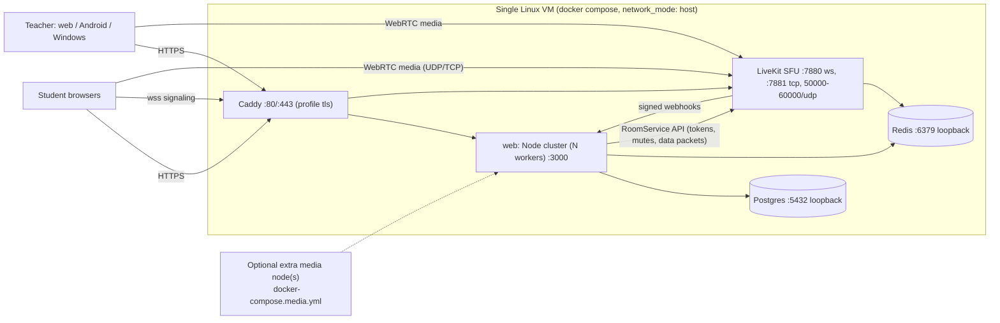

# Repository Architecture

## Branches are products

| Branch | Content | Relation to `main` |
|---|---|---|
| `main` | Server + web app (`apps/web`), AI-teacher MCP server (`apps/ai-teacher`), infra, scripts, docs | — |
| `android` | `main` merged in plus `apps/android` (Kotlin **teacher** app `com.classroom.teacher`) | 171 commits ahead; shares history with `main` (merge-base `5b2fe5e`) |
| `windows` | **Separate history**: Electron **teacher** app "Classroom Teacher" | 29 files under `src/shared/web` copied from `main` by `scripts/sync-web.mjs`, checked by `tests/webSync.test.ts` |
| `ccr-1b6fe3e9-fx7yb9` | Feature branch (share HUD paging), merged into android | — |

**Key fact:** students use **only the web app**. Android and Windows are teacher tools.

## Stack (verified from manifests and lockfiles)

| Layer | Technology | Version |
|---|---|---|
| Web framework | Next.js App Router, React | next 15.5.27, react 19.3 |
| Runtime | Node | 22 (Dockerfile, CI); README says 20 |
| ORM / DB | Prisma → PostgreSQL | prisma 5.22, postgres:16-alpine |
| Cache / bus | ioredis → Redis | redis:7-alpine (AOF, volatile-ttl) |
| Media | LiveKit SFU | livekit-server v1.13.9; livekit-client 2.22.x; livekit-server-sdk 2.7+ |
| Auth | jose (HS256 session JWTs), bcryptjs (cost 12) | — |
| Validation | zod | 3.25.76 |
| Styling | Tailwind | 3.4 |
| Noise removal | @sapphi-red/web-noise-suppressor (RNNoise / Speex WASM worklets, loaded on demand) | 0.4.1 |
| TLS | Caddy 2 (optional profile `tls`) | caddy:2-alpine |
| Android | Kotlin, AppCompat/Material views, OkHttp, livekit-android | minSdk 26, targetSdk 35, livekit-android 2.29.0 |
| Windows | Electron + esbuild + React; Win32 C helper (WGC capture); Rust sidecar (livekit-rust 0.9) | electron 44.10.0 |
| AI teacher | MCP server + orchestrator (TypeScript) | — |

## Deployment topology

## Web app module map (`apps/web/src`, 361 files)

| Area | Paths | Notes |
|---|---|---|
| Pages | `app/{admin,teacher,student,join,join-class,classroom,login,hud}` | 33 routes (build output) |
| API | `app/api/**` | 85 route files: `auth/*`, `admin/*` (42), `rooms/[code]/*` (25), `teacher/*`, `student/*`, `livekit/webhook`, `join-class`, `health` |
| Classroom UI | `components/classroom/*` | `ClassroomRoom.tsx` (4,817 lines) is the shell; StudentViewStage, SelectivePublisher, StudentMediaPrivacy, TeacherPeersFloat, TeacherShareHud, Whiteboard, Chat |
| Domain logic | `lib/*` (~200 files) | Pure `*Logic.ts` modules with injected deps; Redis keys in `lib/redis.ts`; LiveKit in `lib/livekit.ts` |
| Background jobs | `instrumentation.ts` → `retention.ts`, `rankScheduler.ts`, `attendanceQueue.ts`, `teacherPresence.ts`, `micSlotService.ts` | Leader-locked through Redis (`leaderLock.ts`) |
| Middleware | `middleware.ts` + `lib/csrf.ts` | CSRF/Origin guard on `/api/*`, rewrite of `/join?…` |

## Authentication and roles

| Role | Credential | Cookie | Notes |
|---|---|---|---|
| System admin | email + password (bcrypt) | `__Host-classroom_admin` (12 h sliding) | Bootstrapped from `ADMIN_EMAIL`; must change password |
| Sub-admin | email + password, privilege set | same | Can be linked to a teacher (`switch-view`) |
| Teacher | email + password | `__Host-classroom_teacher` (24 h sliding) | One active session (`activeSessionId`) |
| Student ("pupil") | school-app link (signed JWT or **unsigned** params), or the **name form** | `__Host-classroom_pupil` (12 h) + per-class `classroom_student` | See SEC-02 |
| Admin observer | admin session → hidden LiveKit token | — | Listen-only |

## Main data flows
1. **Join:** link/form → `/api/student/join` or `/api/join-class` → pupil cookie → `/student` routes to the current class → `POST /rooms/:code/join` (waiting) → teacher admits → `GET /rooms/:code/token` → LiveKit connect.
2. **State:** clients `GET /rooms/:code/state`; the server pushes `cls-state` data packets (nudges) after changes; the poll is a 60 s safety net while connected.
3. **Chat:** `POST /messages` → Postgres + Redis pub/sub → server data packet `chat` (+ SSE fallback).
4. **Attendance:** LiveKit webhook → Redis queue → batched flush into `AttendanceRecord` (union of connected intervals).

## Subsystem checklist
See AUDIT_PROGRESS.md.
